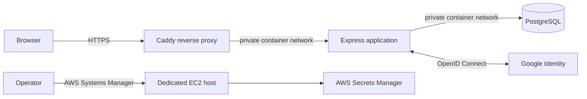

# Northstar Workspace · Authentication Lab

A small, fictional workspace application for learning authentication threat modeling with SecureNow. Register with email and password or Google, enter a role-aware dashboard, and inspect the application code behind the security controls.

**Demo:** [lab-auth.labs.securenow.ai](https://lab-auth.labs.securenow.ai) · **Source:** [securenow-ai/lab-auth](https://github.com/securenow-ai/lab-auth)

This repository is the application and deployment foundation for the tutorial. The recorded tutorial, a SecureNow threat-model report, custom detection rules, and alert-delivery evidence belong to the next phase. The baseline starts without the SecureNow SDK, so the later instrumentation step is visible and reproducible. Use fictional data in the public demo.

## What is included

- Email/password registration and sign-in, Google OpenID Connect sign-in, and sign-out.
- PostgreSQL-backed users, sessions, roles, and security audit events.
- A dashboard with `member`, `analyst`, and `admin` access levels.
- A Node.js 22 / Express application with a plain HTML, CSS, and JavaScript interface.
- Docker Compose for local use; AWS deployment infrastructure and an HTTPS reverse proxy.
- An authentication threat inventory, a Google OAuth setup guide, and a SecureNow integration and verification runbook.

There are no shared admin passwords, committed OAuth credentials, or intentionally weakened public authentication switches. Public registration creates a `member`; higher roles require a server-side administrative action.

## Run locally with Docker

Install Docker with Compose, then clone this repository:

```sh
git clone https://github.com/securenow-ai/lab-auth.git
cd lab-auth
cp .env.example .env
```

In PowerShell, use `Copy-Item .env.example .env` for the last command. Generate three different values; repeat the command for each value:

```sh
node -e "console.log(require('crypto').randomBytes(32).toString('hex'))"
```

Set these values in your private `.env`:

```dotenv
NODE_ENV=development
APP_ORIGIN=http://localhost:3000
POSTGRES_PASSWORD=YOUR_RANDOM_HEX_DATABASE_PASSWORD
SESSION_SECRET=YOUR_DIFFERENT_RANDOM_SESSION_SECRET
AUDIT_HMAC_SECRET=YOUR_DIFFERENT_RANDOM_AUDIT_SECRET
```

Use a hexadecimal database password in Compose so it is safe inside the constructed connection URL. Keep the Google values blank to start with email/password only. Docker Compose supplies the app's internal database URL and bind address.

```sh
docker compose up --build -d
docker compose ps
curl http://localhost:3000/readyz
```

Open [localhost:3000](http://localhost:3000), register a fictional account, and sign in. The app port binds to your machine's loopback interface. PostgreSQL has no published host port. Database data persists in the Compose volume across restarts.

### Create the first administrator

Temporarily set `ADMIN_EMAIL`, `ADMIN_NAME`, and a new `ADMIN_PASSWORD` in your private `.env`, then run:

```sh
docker compose run --rm app node scripts/seed.js
```

Remove `ADMIN_PASSWORD` from `.env` immediately after bootstrap, then recreate the application container to discard the bootstrap password from its environment:

```sh
docker compose up -d --force-recreate app
```

Sign in as that administrator to inspect the role management and audit views. The seed script does not ship a default administrator credential. Re-running it for an existing administrator is a no-op; it does not reset that account's password. It refuses to elevate an existing non-admin account with the same email.

### Add Google sign-in

Follow [Google OAuth setup](docs/google-oauth.md). For local use, register this exact redirect URI:

```text
http://localhost:3000/api/auth/google/callback
```

Set `GOOGLE_CLIENT_ID` and `GOOGLE_CLIENT_SECRET` in your private `.env`, then recreate the app with `docker compose up -d --force-recreate app`. The production callback is:

```text
https://lab-auth.labs.securenow.ai/api/auth/google/callback
```

## Develop and test

For development outside Docker, install Node.js 22 or newer and PostgreSQL 17, create a database, and set `.env` to that database's connection URL:

```sh
npm ci
npm run migrate
npm run dev
```

Use a separate, disposable database for integration tests. Tests may modify its data; never point `TEST_DATABASE_URL` at the deployed lab or a valuable database.

```sh
# Set TEST_DATABASE_URL in your shell to the disposable PostgreSQL database.
npm test
npm run check
node scripts/check-secrets.mjs
npm audit --audit-level=high
```

Database integration tests require `TEST_DATABASE_URL`; when it is absent they are skipped. CI supplies a real PostgreSQL service. The secret checker is a small offline guardrail; review every staged file before publishing. For Docker verification, run `docker build -t lab-auth:local .`.

## Architecture and deployment



The AWS lab uses a dedicated EC2 host, a private container network for PostgreSQL, HTTPS through Caddy, and Systems Manager for operations. It is a single-host teaching deployment; application and database availability share that host. Read [AWS deployment and operations](docs/aws-deployment.md) before provisioning a copy.

| Document | Purpose |
| --- | --- |
| [Authentication threat model](docs/threat-model-authentication.md) | Scope, trust boundaries, controls, and remaining code-level work |
| [Google OAuth](docs/google-oauth.md) | Consent screen, test users, callback URLs, and credential handling |
| [API and smoke tests](docs/api.md) | Routes, CSRF/session contract, and manual verification sequence |
| [SecureNow integration](docs/securenow-integration.md) | Instrumentation, data handling, detections, and controlled mitigation checks |
| [AWS operations](docs/aws-deployment.md) | Provisioning, secrets, HTTPS, smoke tests, backup, and teardown |
| [Security policy](SECURITY.md) | Private reporting and deployment responsibilities |

The SecureNow runbook separates a detected event, a delivered alert, and an enforced mitigation. Record evidence for each when you perform the later tutorial; enabling the SDK alone does not prove any of them.

MIT licensed. Northstar Workspace is fictional and is not affiliated with Google.

